<p align="center">
  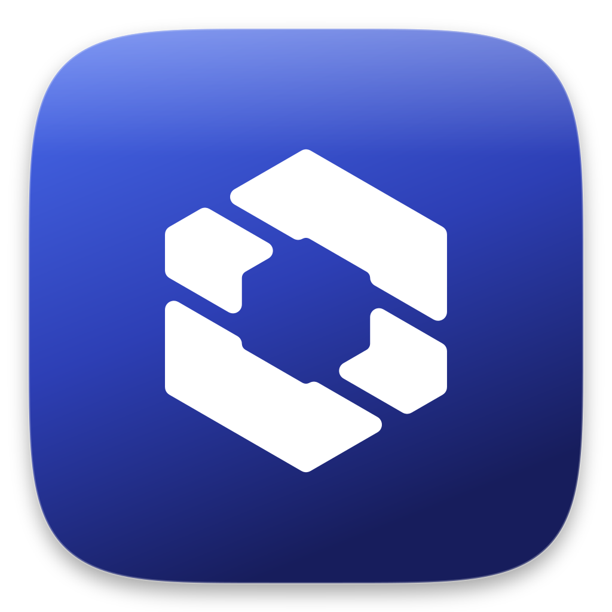
</p>

<h1 align="center">Obelisk</h1>

<p align="center">
  Distro baseada em <b>Arch Linux</b> com desktop próprio escrito em <b>Rust</b>,<br>
  o visual e o jeito do macOS, e foco em <b>desempenho e jogos</b>.
</p>

---

<p align="center">
  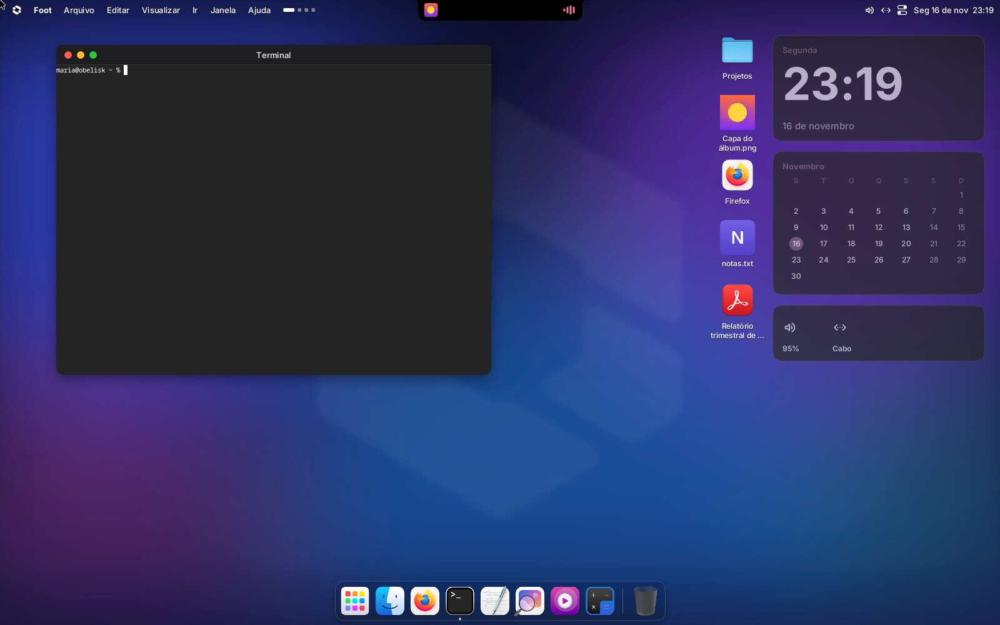
</p>

O Obelisk não usa GNOME, KDE nem Hyprland. O compositor Wayland e todo o shell (barra de menus, Dock,
notch, Busca, Launchpad, Mission Control, Central de Controle, Ajustes, App Store, tela de login e
instalador) são código deste repositório, feito sobre o [Smithay](https://github.com/Smithay/smithay).

> **Propriedade intelectual:** o Obelisk reproduz o *layout, as medidas e o comportamento* do macOS, mas
> nada da Apple é distribuído. O símbolo e os papéis de parede são do Obelisk. Os ícones são o tema
> **WhiteSur** e o cursor é o **MacTahoe** (GPL-3.0, de terceiros). Os símbolos são **Material Symbols**
> (Apache-2.0) e a fonte é a **Inter** (OFL), no lugar da SF Pro.

## O que tem

**Desktop**
- **Barra de menus:** menus do macOS (App, Arquivo, Editar, Visualizar, Ir, Janela, Ajuda) que mandam os atalhos ao app em foco; bandeja de status (Discord, Steam…).
- **Notch:** música com a capa do álbum, HUD de volume e brilho, notificações, Bandeja de arquivos, cartão de captura de tela, gravação, Modo Jogo e o pedido de senha do sistema (polkit).
- **Dock:** com magnificação, apps minimizados e Lixo.
- **Janelas e mesas:** Busca (⌘ Espaço), Launchpad, Mission Control, ⌘Tab, várias mesas, Stage Manager, encaixe de janelas, Forçar Encerrar e Manter na Frente.
- **Central de Controle e Central de Notificações:** a de notificações com widgets.
- **Mesa:** ícones da pasta Área de Trabalho (arrastar, renomear, menu de contexto) e widgets que ficam monocromáticos com um app em foco, como no Sonoma.
- **Capturas e gravação:** ⇧⌘3, ⇧⌘4 e ⇧⌘5, mais gravação de tela.
- **Utilidades:** emojis (⌃⌘ Espaço), zoom de acessibilidade e Monitor de Atividade.
- **Ajustes do Sistema:** 26 páginas que leem e mudam o sistema de verdade: Wi‑Fi com IP manual, Acesso Pessoal, Bluetooth, Som, Telas, Teclado, Mouse, Bateria, Instantâneos, Atualizações, Apps Padrão, Usuários e mais.
- **App Store:** apps do Flathub instalados para o usuário, sem senha.

**Jogos e desempenho**
- **Parado, quase nada:** o compositor não monta a cena quando nada mudou (cerca de 0,3 % de CPU medido).
- **Modo Jogo:** liga sozinho com a Steam, gamescope e afins. Registra o jogo no Feral GameMode, liga o VRR, tira os efeitos e silencia avisos.
- **Jogo em tela cheia:** composto sozinho, com mira em FPS (relative pointer e pointer constraints).
- **Jogos da Steam:** XWayland para jogos X11 e Proton, Proton‑GE e linux‑zen pelos Ajustes, MangoHud.
- **Instalação:** a Steam, o Vulkan de 32 bits e o driver da sua GPU (NVIDIA, AMD ou Intel) vêm prontos.

**Sistema**
- **Telas:** modo nativo DRM/KMS com várias telas, que você arrasta para arrumar como no macOS; tela principal, espelhamento e escala fracionária (125 %, 150 %…).
- **Inicialização:** boot animado (Plymouth) com o símbolo e uma barra de progresso, e tela de login gráfica própria (greetd).
- **Instalador gráfico:** idioma, teclado, disco (com criptografia opcional), conta e progresso.
- **Primeiro uso:** assistente de boas-vindas.
- **Atualizações:** verificadas sozinhas e aplicadas dentro dos Ajustes; Instantâneos (snapper) em btrfs.
- **Protocolos Wayland:** compartilhar a tela (wlr‑screencopy + portal), xdg‑activation, fractional‑scale, presentation‑time, text‑input/input‑method e security‑context (Flatpak).

## Capturas

> Capturas feitas com o Obelisk rodando aninhado, com o usuário de exemplo "Maria Souza".

| | |
|---|---|
| 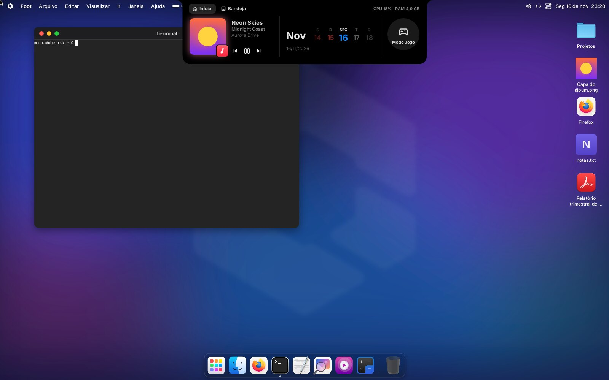 | 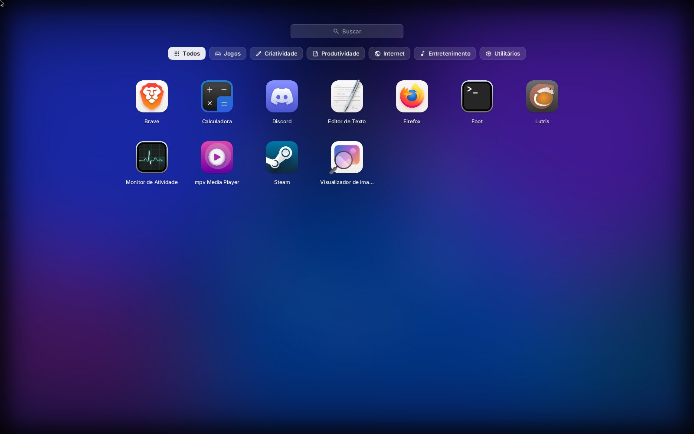 |
| **Notch:** música com a capa, agenda e Modo Jogo | **Launchpad** com categorias |
| 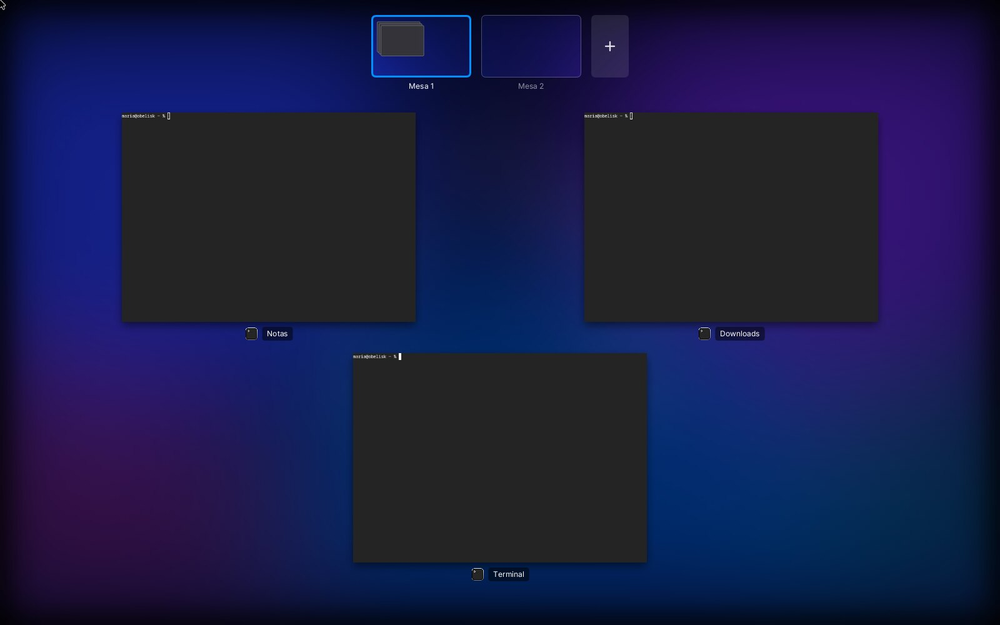 | 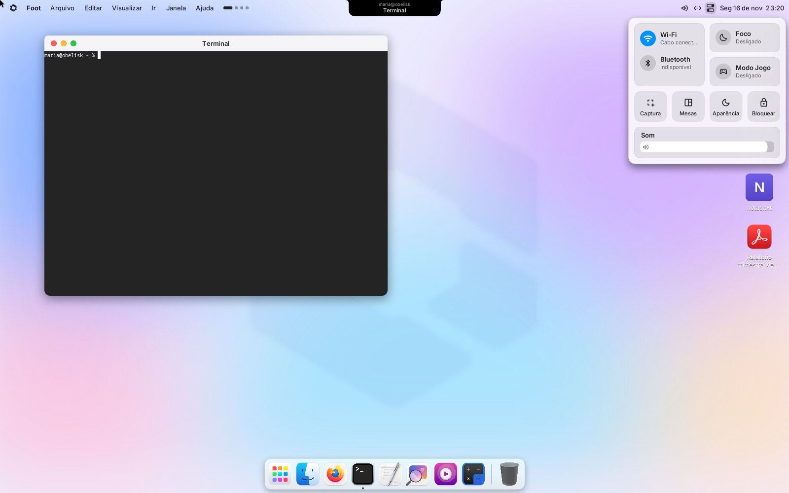 |
| **Mission Control** com as mesas | **Central de Controle** (modo claro) |
| 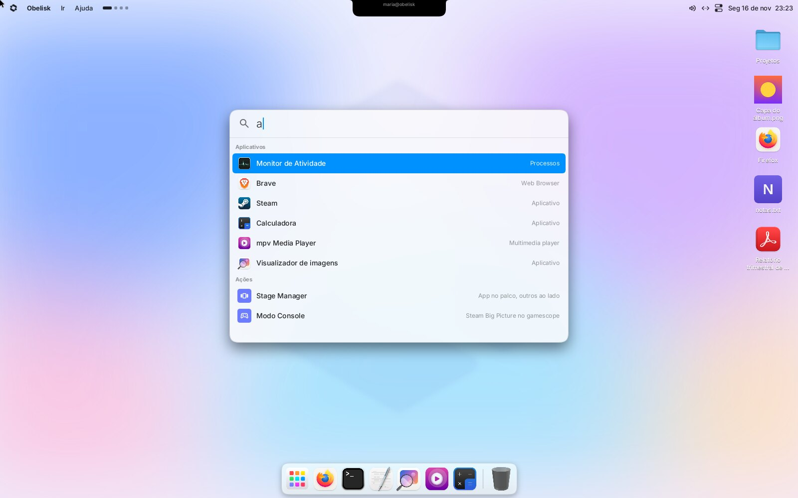 | 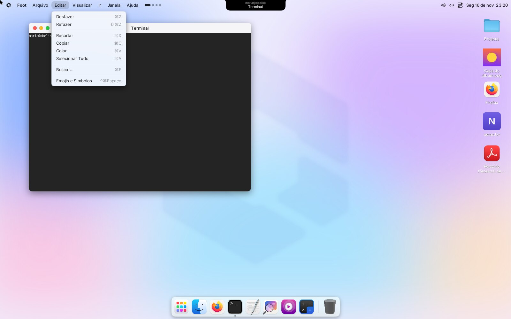 |
| **Busca** (⌘ Espaço) | **Barra de menus** com Arquivo, Editar, Visualizar… |
| 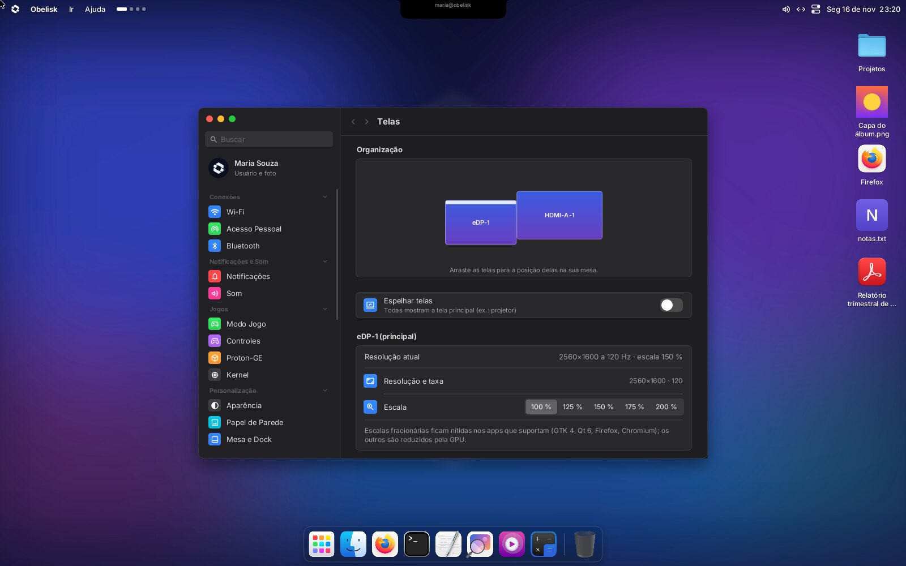 | 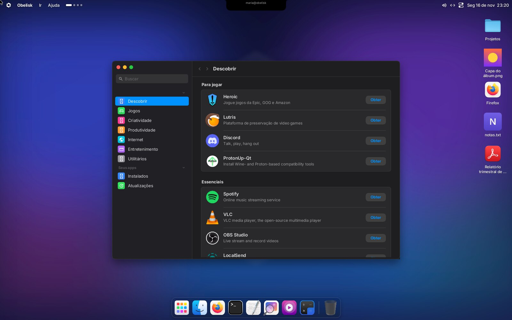 |
| **Ajustes › Telas:** arraste os monitores | **App Store** com apps do Flathub |
| 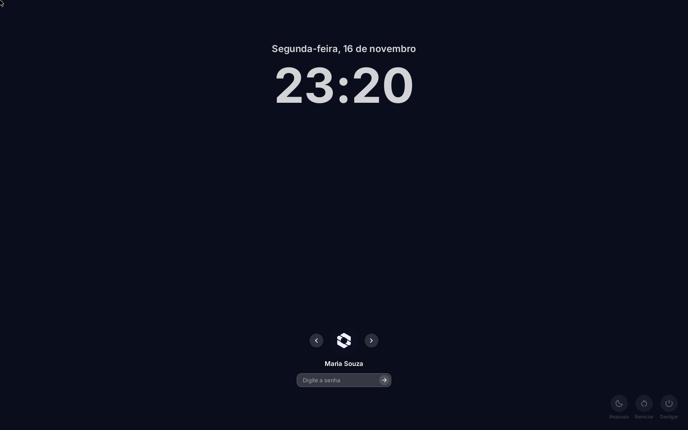 | 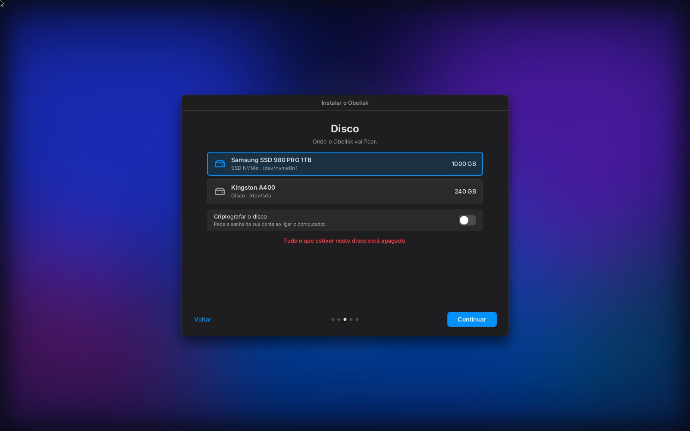 |
| **Tela de login** com troca de usuário | **Instalador gráfico** |
| 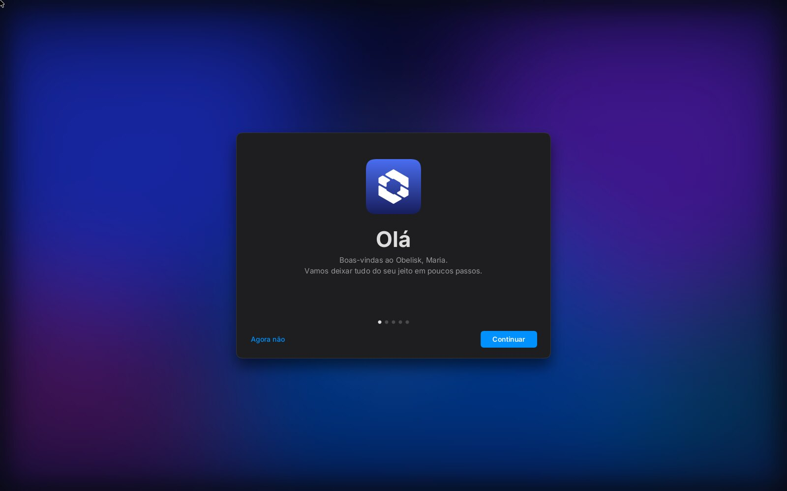 | |
| **Assistente** de primeiro uso | |

## Estado

O desktop foi desenvolvido e verificado rodando **aninhado**, como uma janela dentro de outro compositor.

| Parte | Estado |
|---|---|
| Visual, notch, Dock, menus, Ajustes, App Store, instalador e login (desenho) | ✅ verificados em capturas |
| XWayland e dmabuf (OpenGL/Vulkan), captura de tela pelo `grim` | ✅ testados dentro do Obelisk |
| Login com o greetd | ✅ testado contra um greetd simulado |
| Backend nativo (várias telas, hotplug, VRR, Night Shift) | 🟡 escrito, **nunca executado em hardware** |
| ISO e instalação | 🟡 escritos, **ISO ainda não gerada** |
| Boot animado (Plymouth) | 🟡 escrito, visto só numa prévia estática |

Detalhes, item por item: [`docs/`](docs/).

## Rodar em desenvolvimento

Abre como uma janela; não substitui a sua sessão.

```bash
cargo build --release
scripts/run-nested.sh                  # Obelisk numa janela, com um terminal dentro
scripts/run-nested.sh --dark
./target/release/obelisk-compositor --help
```

No modo aninhado o atalho principal é **Alt**, porque o compositor hospedeiro captura o Super. Na sessão
real é o **⌘ (Super)**, que também chega aos apps como Ctrl (⌘C, ⌘V, ⌘W…).

Para testar sem interagir, use `--debug-ui` para abrir uma tela específica e `--debug-capture 5000:arquivo.png`
para capturá-la depois de 5 s e encerrar. Exemplos: `settings:displays`, `open:store`, `installer:2`,
`welcome`, `notch`, `launchpad`, `mission`, `cc` e `menu:edit`.

Para capturas de divulgação, `OBELISK_DEMO_USER="Maria Souza"` troca usuário, máquina, discos e lista de
apps por dados de exemplo, e `OBELISK_VIRTUAL_SIZE=1600x1000` desenha numa tela desse tamanho,
independente da janela.

## Gerar a ISO e testar numa máquina virtual

```bash
sudo pacman -S --needed archiso qemu-desktop edk2-ovmf
scripts/build-iso.sh       # gera os pacotes obelisk-desktop/obelisk-themes e a ISO em out/
scripts/test-vm.sh         # boot da ISO no QEMU (UEFI, GPU virtio com 3D) com um disco de 40 GB
scripts/test-vm.sh --disk  # boot do sistema já instalado
```

O sistema live abre o instalador; "Experimentar primeiro" leva ao desktop. Para o sistema instalado
receber atualizações do Obelisk, publique `repo/x86_64` num servidor estático e gere a ISO com
`OBELISK_REPO_URL=https://…/x86_64`.

## Atalhos principais

| Atalho | Ação |
|---|---|
| `⌘ Espaço` | Busca: apps, contas, ações, arquivos, web |
| `⌘ Tab` | Trocar de app |
| `⌃ ↑` / `⌃ ↓` | Mission Control / App Exposé |
| `⌘ 1…9` | Ir para a mesa |
| `⌘ Q` / `⌘ W` / `⌘ M` / `⌘ H` | Encerrar / fechar / minimizar / ocultar |
| `⌃⌘ F` | Tela cheia |
| `⇧⌘ 3` / `⇧⌘ 4` / `⇧⌘ 5` | Capturas e gravação |
| `⌥⌘ Esc` | Forçar Encerrar |
| `⌃⌘ Espaço` | Emojis |
| `⌃⌘ Q` | Bloquear a tela |
| `⌥⌘ 8` | Zoom de acessibilidade |

## Estrutura

```
crates/obelisk-comp/        compositor + shell (Rust)
  src/backend/              winit (aninhado) e drm (nativo, várias telas)
  src/shell/                barra, Dock, notch, Busca, Launchpad, Ajustes, App Store, instalador…
  src/handlers/             protocolos Wayland
  src/screencopy.rs         wlr-screencopy (compartilhar a tela)
  src/ui/                   canvas (tiny-skia), texto (fontdue), ícones, molas do SwiftUI
branding/                   símbolo, ícones, papéis de parede, Plymouth e GRUB
packaging/                  PKGBUILDs: obelisk-desktop e obelisk-themes
profile/                    perfil archiso (ISO live + instaladores)
scripts/                    build-repo · build-iso · test-vm · run-nested
docs/                       análise do macOS, design system, especificações e estado
```

## Licença

GPL-3.0-or-later (veja [LICENSE](LICENSE)). Partes de `grabs/` e `handlers/` derivam do exemplo `smallvil`
do Smithay (MIT). Os temas WhiteSur e MacTahoe são baixados no empacotamento e não ficam neste repositório.
